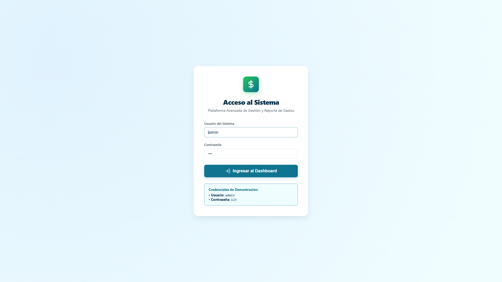
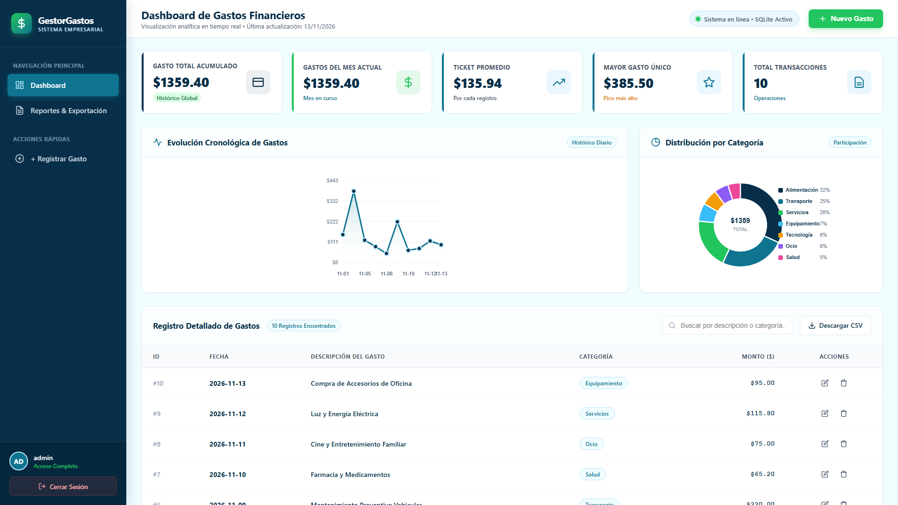
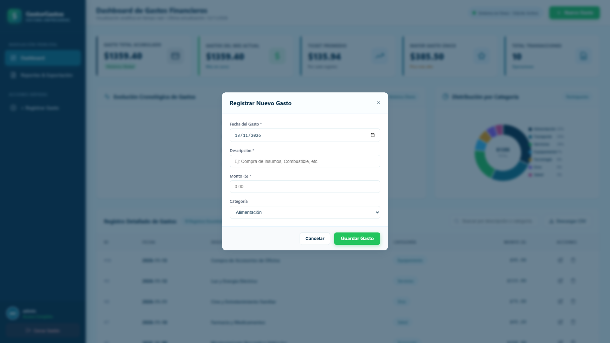
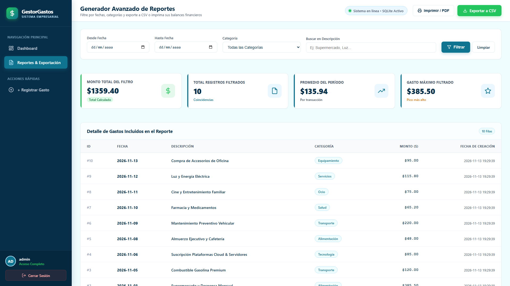

# 💳 GestorGastos - Sistema Empresarial de Control Financiero

Un moderno sistema web desarrollado en **Python + Flask + SQLite** para la administración, análisis y generación de reportes de gastos personales o empresariales. Cuenta con una arquitectura tipo **Dashboard Avanzado Full-Width** que ocupa toda la pantalla, diseñado siguiendo una paleta corporativa moderna de alta fidelidad.

---

## 🎨 Paleta de Colores Corporativa Oficial

El diseño visual de la interfaz fue construido bajo la siguiente guía cromática:

| Color Muestra | Código Hex | Rol en el Sistema | Uso en Interfaz |
| :---: | :---: | :--- | :--- |
|  | **`#082F49`** | Deep Cyan Navy | Sidebar lateral, encabezados principales, tipografía y tarjetas de contraste. |
|  | **`#0E7490`** | Ocean Teal | Navegación activa, gráficos de evolución, botones de acción y acentos. |
|  | **`#22C55E`** | Emerald Green | Botón principal de Nuevo Gasto, indicadores de métricas y badges de éxito. |
|  | **`#BAE6FD`** | Sky Blue Tint | Badges de categorías, bordes sutiles, halos de puntos en gráficos y foco. |
|  | **`#F0FDFF`** | Ice Background | Fondo general del viewport completo (100vw x 100vh) limpio y espacioso. |

---

## 🚀 Credenciales de Acceso

Para acceder al sistema utilice las credenciales configuradas:

- **Usuario:** `admin`
- **Contraseña:** `123`

---

## 📸 Demostración y Capturas de Pantalla

### 1. Pantalla de Autenticación (Login)
Interfaz de inicio de sesión con validación de credenciales en base de datos SQLite y sesiones protegidas.


---

### 2. Dashboard Analítico Full-Width
Vista panorámica de pantalla completa con 5 tarjetas de KPIs en tiempo real, gráfico de evolución cronológica, gráfico de distribución por categoría y tabla interactiva de gastos con búsqueda en vivo.


---

### 3. Registro de Nuevo Gasto (Modal Dinámico)
Ventana modal interactiva con campos requeridos: **Fecha**, **Descripción**, **Monto** y **Categoría** con soporte para validación instantánea.


---

### 4. Generador Avanzado de Reportes y Exportación
Módulo dedicado para filtrar gastos por rango de fechas (Desde / Hasta), categorías específicas y términos de búsqueda. Incluye cálculo de sumatorias, promedios y botones para **Exportar a CSV (Excel)** e **Imprimir / Guardar en PDF**.


---

## ✨ Características Principales

1. **Gestión de Acceso Seguro**:
   - Autenticación con sesión de usuario (`admin` / `123`).
   - Control de sesiones con cierre seguro (`/logout`).
   - Rutas privadas protegidas con decorador `@login_required`.

2. **Registro de Gastos (CRUD Completo)**:
   - **Campos Requeridos:** Fecha (`fecha`), Descripción (`descripcion`) y Monto (`monto`).
   - **Categorización:** Alimentación, Servicios Básicos, Transporte, Tecnología, Salud, Ocio, Equipamiento y Otros.
   - **Edición y Eliminación:** Modificación de registros en modal y eliminación con confirmación interactiva.

3. **Dashboard Avanzado a Pantalla Completa**:
   - Aprovecha el 100% del viewport (`100vw` y `100vh`) sin espacios vacíos.
   - **5 Tarjetas de KPIs:**
     - Gasto Total Acumulado ($)
     - Gastos del Mes en Curso ($)
     - Ticket Promedio por Transacción ($)
     - Mayor Gasto Único ($)
     - Total de Transacciones Registradas (#)
   - **Gráficos en Canvas:** Gráfico de evolución de gastos por fecha y gráfico de dona para participación por categoría.
   - **Búsqueda Instantánea:** Filtro en tiempo real por texto o categoría en la tabla sin recargar la página.

4. **Generador y Exportador de Reportes**:
   - Filtros combinados por rango de fechas y categoría.
   - Métricas dinámicas calculadas automáticamente sobre el subconjunto filtrado.
   - **Descarga directa en CSV compatible con Microsoft Excel** (con codificación UTF-8 con BOM).
   - Vista optimizada para impresión física o guardado en PDF (`Ctrl + P` o botón directo).

---

## 🛠️ Tecnologías Utilizadas

- **Backend:** Python 3.x & Flask 3.1
- **Base de Datos:** SQLite 3 (`gastos.db`)
- **Frontend:** HTML5 Semántico, CSS Grid & Flexbox, JavaScript nativo (ES6+)
- **Visualización Gráfica:** HTML5 Canvas de alto rendimiento con aceleración por hardware
- **Control de Versiones:** Git & GitHub

---

## 📁 Estructura del Proyecto

```
PRATICA WB/
│
├── app.py                  # Servidor Flask principal y lógica de rutas/controladores
├── database.py             # Script de inicialización y conexión a SQLite (gastos.db)
├── requirements.txt        # Dependencias de Python requeridas
├── generate_screenshots.py # Script de automatización de capturas en alta resolución
│
├── static/
│   ├── css/
│   │   └── dashboard.css   # Hoja de estilos con la paleta de colores oficial y layout full-screen
│   └── js/
│       └── dashboard.js    # Motor de renderizado de gráficos Canvas y filtros dinámicos
│
├── templates/
│   ├── base.html           # Plantilla base con Sidebar, Topbar y estructura común
│   ├── login.html          # Vista de inicio de sesión
│   ├── dashboard.html      # Vista del Dashboard analítico y tabla de transacciones
│   └── reportes.html       # Vista del módulo de reportes con filtros y exportación
│
├── screenshots/            # Capturas de pantalla integradas en el README
│   ├── 01_login.png
│   ├── 02_dashboard.png
│   ├── 03_registro_gasto.png
│   └── 04_reportes.png
│
├── gastos.db               # Base de datos SQLite generada automáticamente
└── README.md               # Documentación completa del proyecto
```

---

## ⚙️ Instrucciones de Instalación y Ejecución

Sigue estos sencillos pasos para ejecutar el proyecto en tu entorno local:

### 1. Clonar el Repositorio
```bash
git clone https://github.com/<tu-usuario>/control-gastos-flask.git
cd control-gastos-flask
```

### 2. Instalar Dependencias
Se recomienda usar un entorno virtual de Python:
```bash
python -m pip install -r requirements.txt
```

### 3. Iniciar la Aplicación
```bash
python app.py
```

### 4. Abrir en el Navegador
Abre tu navegador web e ingresa a:
```
http://127.0.0.1:5000
```
Inicia sesión con:
- **Usuario:** `admin`
- **Contraseña:** `123`

---

## 📄 Licencia

Este proyecto fue desarrollado con fines educativos y de práctica bajo la licencia MIT.
