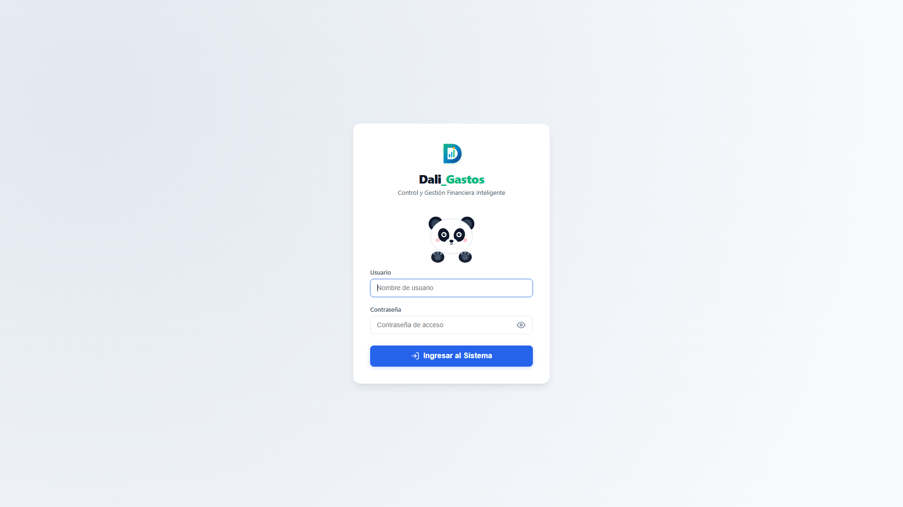
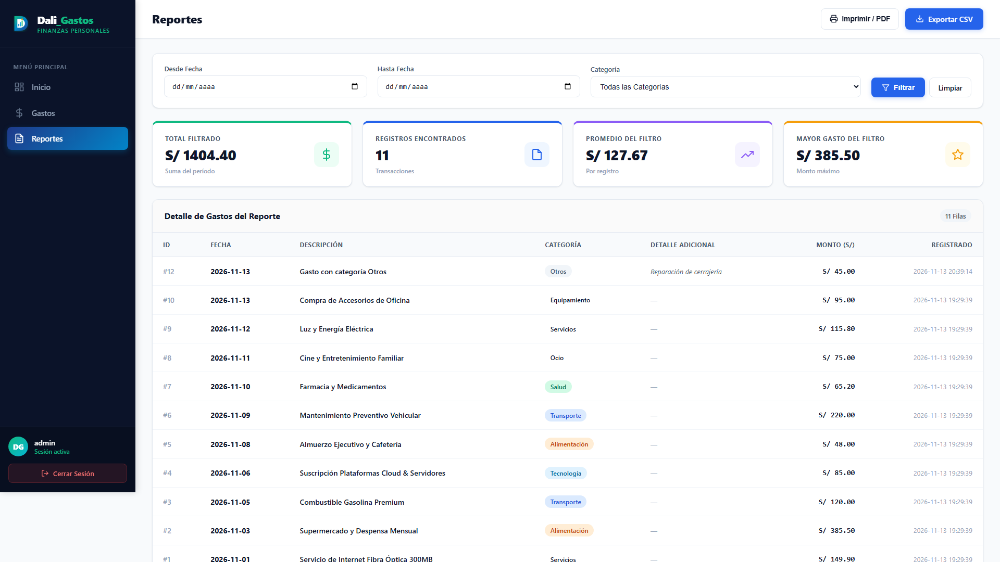

<div align="center">


# Dali_Gastos
### Sistema Web de Gestión y Reportes de Gastos Financieros

[](https://www.python.org/)
[](https://flask.palletsprojects.com/)
[](https://www.sqlite.org/)
[](https://github.com/DarioLipa/control-gastos-flask/actions)
[](LICENSE)

</div>

---

## 📌 Presentación

**Dali_Gastos** es una plataforma web integral orientada al control, análisis y reporte de finanzas personales y operativas. Diseñada bajo una arquitectura limpia y responsiva, ofrece una experiencia de usuario de tipo *Financial Dashboard* que aprovecha eficientemente todo el ancho de pantalla en monitores de escritorio, tablets y dispositivos móviles.

La aplicación centraliza la administración de egresos en soles peruanos (**S/**), proporcionando métricas en tiempo real, desglose visual por categorías y herramientas de auditoría con exportación a formatos estándar.

---

## 📸 Demostración Visual

### 1. Inicio de Sesión Interactivo
Acceso autenticado con una mascota interactiva (panda en SVG vectorial) que reacciona de forma fluida a la interacción con los campos de entrada: sigue la escritura en el campo de usuario, se cubre los ojos al enfocar la contraseña y espía cuando se activa la visualización de la clave.
<div align="center">
  
</div>

---

### 2. Dashboard Analítico
Panel de inteligencia visual que sintetiza la información financiera sin redundancias. Incluye 5 tarjetas de KPIs con esquinas redondeadas y colores diferenciados, evolución temporal de gastos, gráfico de dona por participación y ranking de las categorías con mayor volumen.
<div align="center">
  
</div>

---

### 3. Módulo de Gestión de Gastos
Punto central de administración de registros con tabla interactiva de ancho completo, buscador en vivo por descripción, selector de categorías, visualización de moneda oficial (**S/**) y diálogo modal para registrar, editar y eliminar gastos con confirmación segura.
<div align="center">
  
</div>

---

### 4. Módulo de Reportes y Exportación
Módulo especializado para la generación de balances filtrados por rango de fechas y categorías. Recalcula de forma dinámica sumatorias, promedios y picos de gasto, con funciones directas de exportación a CSV (compatible con Microsoft Excel con codificación UTF-8 con BOM) e impresión optimizada para PDF.
<div align="center">
  
</div>

---

## ✨ Funcionalidades Principales

- **Seguridad Web:** Contraseñas protegidas mediante algoritmos de hash seguros (`scrypt` / `pbkdf2`), protección CSRF en peticiones mutables, cookies de sesión con flags `HttpOnly` y `SameSite=Lax`, y limitador de tasa de intentos fallidos en el login.
- **Arquitectura sin Redundancias:** Separación estricta de responsabilidades entre el panel de métricas (Dashboard), el centro de administración de datos (Gastos) y la generación de balances (Reportes).
- **Catálogo Ampliado de 15 Categorías:** Alimentación, Transporte, Vivienda, Servicios básicos, Salud, Educación, Compras, Entretenimiento, Tecnología, Comunicación, Vestimenta, Viajes, Deudas, Imprevistos y Otros (con campo para detalle adicional).
- **Visualización Gráfica Nativa:** Renderizado de gráficos de alto rendimiento en HTML5 Canvas con aceleración gráfica por hardware sin requerir librerías externas o CDNs que bloqueen el uso fuera de línea.
- **Exportación e Impresión:** Descarga de reportes filtrados en archivo `.csv` y estilos `@media print` preparados para generar documentos PDF limpios.

---

## 🛠️ Tecnologías Utilizadas

- **Backend:** Python 3.12 / 3.14, Flask 3.1.3, Werkzeug 3.1.9
- **Base de Datos:** SQLite 3
- **Frontend:** HTML5 Semántico, CSS Grid & Flexbox responsivo, JavaScript nativo (ES6+)
- **Testing:** Pytest 9.2.0
- **Servidor WSGI para Producción:** Gunicorn 23.0.0
- **Integración Continua:** GitHub Actions (`ci.yml`)

---

## ⚙️ Instalación y Ejecución Local

Para ejecutar el proyecto en tu entorno local con Windows PowerShell:

### 1. Clonar el Repositorio
```powershell
git clone https://github.com/DarioLipa/control-gastos-flask.git
cd control-gastos-flask
```

### 2. Instalar Dependencias
```powershell
python -m pip install -r requirements.txt
```

### 3. Iniciar el Servidor Flask
```powershell
python app.py
```

### 4. Acceder en el Navegador
Abre tu navegador e ingresa a:
```
http://127.0.0.1:5000
```

---

## 🔑 Acceso de Demostración Local

Para fines de evaluación académica y pruebas locales, el sistema inicializa automáticamente las siguientes credenciales de desarrollo:

- **Usuario:** `admin`
- **Contraseña:** `123`

> [!IMPORTANT]
> Estas credenciales son de uso exclusivo en entornos locales de práctica. En un despliegue de producción se deben configurar credenciales seguras mediante las variables de entorno `ADMIN_USER` y `ADMIN_PASSWORD`.

---

## 🗄️ Base de Datos y Persistencia

El sistema utiliza **SQLite** (`gastos.db`). La estructura de tablas se genera y actualiza automáticamente al iniciar la aplicación mediante `database.py`:
- `usuarios`: Almacena el usuario administrador con contraseña protegida mediante hash.
- `gastos`: Contiene fecha, descripción, monto numérico positivo, categoría seleccionada y detalle opcional para la categoría *Otros*.

---

## 🚀 Despliegue en Producción

La aplicación está lista para desplegarse en plataformas como **Render**, **Railway** o servidores Linux con soporte WSGI:

1. Configurar el comando de inicio en el servicio de hosting:
   ```bash
   gunicorn app:app
   ```
2. Asociar un disco o volumen persistente montado en la ruta del archivo SQLite (definido en la variable `DATABASE_PATH`).
3. Definir las variables de entorno en el panel del proveedor (ver `.env.example`):
   - `FLASK_ENV=production`
   - `SECRET_KEY=clave_aleatoria_segura_de_32_bytes`
   - `ADMIN_USER=tu_usuario_seguro`
   - `ADMIN_PASSWORD=tu_contraseña_compleja`
   - `DATABASE_PATH=/data/gastos.db`

El repositorio incluye el archivo de configuración declarativa `render.yaml`.

---

## 🧪 Pruebas Automatizadas

El proyecto incluye una suite de pruebas con `pytest` que valida la autenticación, control de acceso, operaciones CRUD, validaciones de montos y fechas, y generación de reportes:

```powershell
python -m pytest -v
```

---

## 🎓 Información Académica

Proyecto académico desarrollado como práctica calificada en la **Universidad Privada de Trujillo (UPRIT)**.

---

## 👤 Autor

**Dario Solano Lipa Sacaca**  
GitHub: [@DarioLipa](https://github.com/DarioLipa)
