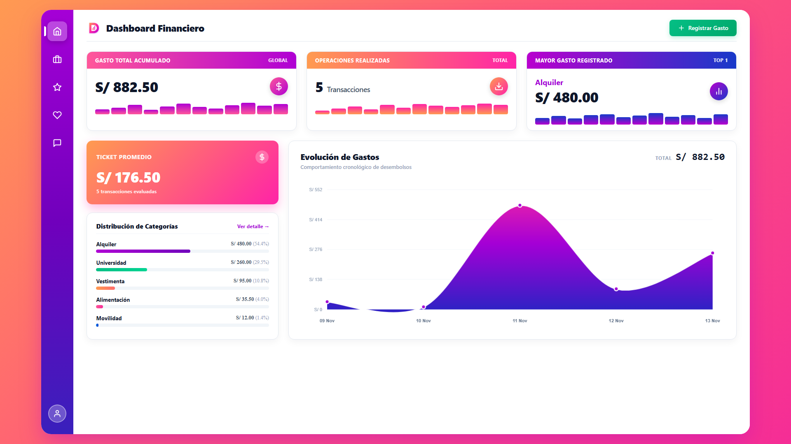
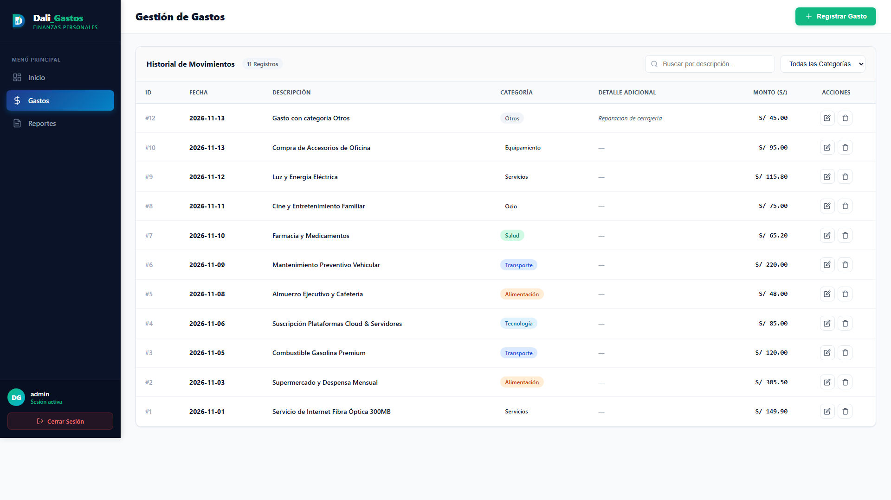

<div align="center">


# Dali_Gastos
### Sistema Web Financiero con Flask y SQLite

[](https://www.python.org/)
[](https://flask.palletsprojects.com/)
[](https://www.sqlite.org/)
[](https://github.com/DarioLipa/control-gastos-flask/actions)
[](LICENSE)

</div>

---

## 📌 Presentación del Proyecto

**Dali_Gastos** es un sistema web de control financiero personal y analítico desarrollado en **Python, Flask y SQLite**. La interfaz ofrece un diseño moderno con fondos degradados, barra lateral estilizada, tarjetas con indicadores financieros y un gráfico continuo de evolución cronológica.

El sistema registra egresos en moneda nacional (**S/**), calcula automáticamente balances y genera reportes filtrados con exportación a formato CSV e impresión en PDF.

---

## 📸 Demostración Visual

### 1. Dashboard Financiero Principal
Composición equilibrada con 3 tarjetas superiores con degradados, panel lateral de distribución por categorías con barras de progreso y un gráfico amplio de área continua para la evolución de gastos.
<div align="center">
  
</div>

---

### 2. Inicio de Sesión Interactivo
Acceso al sistema con mascota vectorial interactiva que reacciona a los campos de entrada: sigue la escritura en el usuario, se cubre los ojos al enfocar la contraseña y espía al alternar la visibilidad de la clave.
<div align="center">
  
</div>

---

### 3. Gestión de Gastos Centralizada
Módulo para registrar, buscar, editar y eliminar gastos en soles peruanos (**S/**), con selector de categorías y validación de datos en servidor.
<div align="center">
  
</div>

---

### 4. Módulo de Reportes
Pantalla dedicada a la generación de balances filtrados por fechas y categorías, con recálculo dinámico de totales y exportación directa en formato CSV compatible con Microsoft Excel.
<div align="center">
  
</div>

---

### Credenciales de Demostración Local
- **Usuario:** `admin`
- **Contraseña:** `123`

---

## 🧪 Pruebas Automatizadas

El proyecto cuenta con una suite de 10 pruebas unitarias e integración con Pytest:

```powershell
python -m pytest -v
```

---

## 🚀 Despliegue en Servidor de Producción

Para desplegar en servicios compatibles con Python (como Render o servidores Linux):

1. Comando de inicio WSGI:
   ```bash
   gunicorn app:app
   ```
2. Configurar almacenamiento persistente para el archivo SQLite montado en `/data/gastos.db`.
3. Variables de entorno recomendadas:
   - `FLASK_ENV=production`
   - `SECRET_KEY=clave_aleatoria_segura_de_32_bytes`
   - `ADMIN_USER=tu_usuario`
   - `ADMIN_PASSWORD=tu_contraseña_segura`
   - `DATABASE_PATH=/data/gastos.db`

---

## 🎓 Información Académica

Proyecto académico desarrollado como práctica calificada en la **Universidad Privada de Trujillo (UPRIT)**.

---

## 👤 Autor

**Dario Lipa**  
GitHub: [@DarioLipa](https://github.com/DarioLipa)
